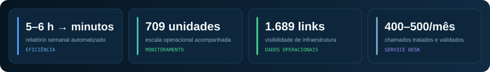

  

  
  
  

<h3 align="center">Dados operacionais transformados em indicadores, automações e decisões claras.</h3>

  Analista de Dados Jr. e estudante de Data Science na FIAP, com experiência prática em
  operações NOC, qualidade de dados, dashboards e automação de processos.
   
  São Paulo/SP · Python · SQL · Power BI · PostgreSQL · Excel · ETL

  

## Projetos selecionados

<table>
  <tr>
    <td width="50%" valign="top">
      <h3>📊 <a href="https://github.com/CelsoKaiqueSil/coreops-noc-dashboard">CoreOps NOC Dashboard</a></h3>
      
<strong>Projeto principal · Analytics operacional</strong>

      
Pipeline ETL e dashboard para disponibilidade, SLA, MTTR, recorrência e priorização de incidentes, com matching e deduplicação auditáveis.

      
<code>Python</code> <code>Pandas</code> <code>PostgreSQL</code> <code>SQL</code> <code>JavaScript</code>

    </td>
    <td width="50%" valign="top">
      <h3>📡 <a href="https://github.com/CelsoKaiqueSil/zabbix-reporting-pipeline">Zabbix Reporting Pipeline</a></h3>
      
<strong>Monitoramento · API somente leitura</strong>

      
Classificação de CPU, memória e tráfego, análise de picos e geração de relatórios Excel rastreáveis sem expor ambientes reais.

      
<code>Python</code> <code>API Zabbix</code> <code>Pandas</code> <code>Excel</code>

    </td>
  </tr>
  <tr>
    <td width="50%" valign="top">
      <h3>🎯 <a href="https://github.com/CelsoKaiqueSil/service-desk-analytics">Service Desk Analytics</a></h3>
      
<strong>Business Intelligence · SLA</strong>

      
Indicadores de backlog, resolução, primeira resposta e solução, combinando média, mediana e P90 para leituras mais confiáveis.

      
<code>Python</code> <code>Pandas</code> <code>KPIs</code> <code>Excel</code>

    </td>
    <td width="50%" valign="top">
      <h3>⚙️ <a href="https://github.com/CelsoKaiqueSil/fortiview-excel-automation">FortiView Excel Automation</a></h3>
      
<strong>Automação de processos · Planilhas</strong>

      
Normalização de tráfego, prevenção de duplicidades, backup e atualização agendada de planilhas operacionais.

      
<code>Python</code> <code>openpyxl</code> <code>PowerShell</code> <code>Excel</code>

    </td>
  </tr>
</table>

## Ferramentas

  
  
  
  
  
  

  
  
  
  
  
  
  

## Como trabalho

<table>
  <tr>
    <td width="33%" align="center">
      <strong>01 · Entender</strong> 
      Problema, processo e necessidade das pessoas antes da tecnologia.
    </td>
    <td width="33%" align="center">
      <strong>02 · Construir</strong> 
      ETL, indicadores e automações com regras claras e rastreabilidade.
    </td>
    <td width="33%" align="center">
      <strong>03 · Validar</strong> 
      Testes, qualidade e comunicação objetiva dos resultados.
    </td>
  </tr>
</table>

  Todos os projetos públicos utilizam dados sintéticos e não expõem informações corporativas.

